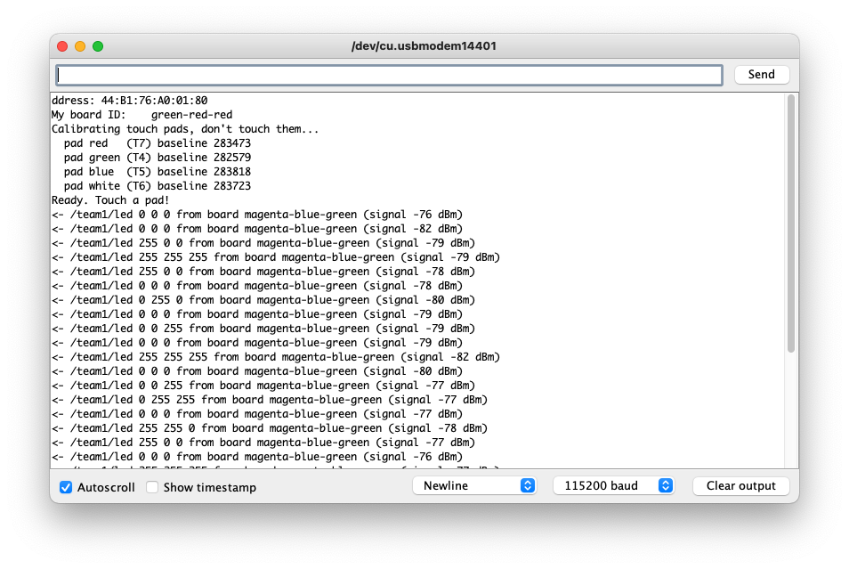

# OSC in the field, with ESP-NOW

## Where we are

Last week you sent **OSC over [Wi-Fi](https://en.wikipedia.org/wiki/Wi-Fi)**. Every board joined the same Wi-Fi network, and the messages went through a [router](https://en.wikipedia.org/wiki/Router_(computing)) to reach the other board or your computer.

That works in the lab. But when you take your intervention **to the site** (a street, a park, a market, an empty building), there is usually no Wi-Fi you can use: you don't know the password, the signal doesn't reach, or there's no router at all.

This week we do **OSC without a central Wi-Fi**. The boards talk **directly to each other** using **ESP-NOW**. You keep the OSC you already know and drop the router. Bring your boards and a USB power bank, and it works wherever you are.

## The example: Touch → OSC → ESP-NOW → NeoPixel

The smallest version of that idea: two Barduinos talking through the air, with no network and no cables.

**Touch a pad on one board, and the coloured light (the NeoPixel) on the other board turns on.** It works both ways.

| Pad | Colour |
|-----|--------|
| T7  | red    |
| T4  | green  |
| T5  | blue   |
| T6  | white  |

Touch two pads at once and the colours mix: red + green = yellow.

```
   Board A                                         Board B
   touch T7  ───── "show red!" ─────────────────►  NeoPixel turns red
   LED blinks ◄──── "ok, I'm red" ───────────────┘
```

Both boards run **the same sketch**. Each one sends and receives.

### How to read this page

| Part | What you get | When |
|---|---|---|
| **[1. Get it running](#part-1-get-it-running)** | the example working on your two boards, with your team name | now |
| **[2. How it works](#part-2-how-it-works)** | what happens inside, step by step | after it works |
| **[3. Use it in your own OSC sketches](#part-3-use-it-in-your-own-osc-sketches)** | turn your Wi-Fi OSC projects into ESP-NOW | when you build your own |
| **[4. Out in the real world](#part-4-out-in-the-real-world)** | distance, walls, many boards | before an installation or a show |

Stuck? Go to **[Help](#help)** at the end.

---

## Part 1. Get it running

### What you need

- 2 Barduinos (4.0.2) **with the NeoPixel soldered on**
- 2 USB-C cables that carry **data**. Some cables only charge, and with those the computer never sees the board.
- Arduino IDE

### Install

1. **Tools → Board → Boards Manager**, search **esp32 by Espressif Systems**, choose version **3.3.13** in the dropdown, and install.
   > ⚠️ **Not 4.0.0.** In that version the touch pads don't work at all.
2. **Tools → Manage Libraries**, search and install **OSC** by Adrian Freed. It's the same OSC library you use for Wi-Fi.
3. In the **Tools** menu:
   - Board: **ESP32S3 Dev Module**
   - USB CDC On Boot: **Enabled** (without it, the Serial Monitor stays empty)
   - Everything else as on the [Barduino setup page](https://fablabbcn-projects.gitlab.io/electronics/barduino-docs/GettingStarted/arduinoIDE/)

### Upload and meet your boards

1. Upload the sketch to **both** boards.
   If the upload fails: hold **BOOT**, press **RESET**, release **BOOT**, and upload again.
2. Open the Serial Monitor (115200) and press **RESET** on the board. **Don't touch the pads while it starts**: it is measuring them.
3. Watch the NeoPixel: it blinks **three colours**, for example *yellow, blue, blue*. That's the board's **colour ID**. It never changes, and every board has its own.
4. The Serial Monitor shows the same thing:
   ```
   My MAC address: 10:20:BA:14:30:94
   My board ID:    yellow-blue-blue
   Calibrating touch pads, don't touch them...
     pad red   (T7) baseline 283836
     ...
   Ready. Touch a pad!
   ```
5. Write down the colours of both of your boards. A sticker on each board helps.

The colours come from the board's MAC address, its unique hardware number (more about it in Part 2). The number is mixed with a [hash function](https://en.wikipedia.org/wiki/Hash_function), so two boards with almost the same number still get very different colours.

### Make it your team

Every **pair** of boards in the room needs its own **team name**, so your boards don't react to the other pairs. Use the colour ID of **one of your two boards**. Open `touch_osc_espnow.ino` and change this line:

```cpp
#define TEAM "/yellow-blue-blue"
```

Upload again to **both** boards, with the same team name.

> **Can two pairs get the same colours?** With 3 colours there are 216 possible IDs. In a room of 12 boards, there's about a 1 in 4 chance that two boards share an ID, so look around when everyone starts their boards. If your team name is already taken, use your other board's colours.

### Play

Touch a pad on one board and look at the **other** board. 🎉

### Reading the Serial Monitor

The Serial Monitor is where the board tells you what it's doing, line by line. It is your best friend when something doesn't work.

**Open it:**

1. **Tools → Port**: choose your board (`/dev/cu.usbmodem…` on Mac, `COM…` on Windows).
2. **Tools → Serial Monitor**, or the magnifying-glass icon at the top right.
3. Set the speed to **115200 baud** (dropdown at the bottom). Strange characters mean the speed is wrong.
4. Press **RESET** on the board to see everything from the start.

One Serial Monitor shows **one board**. To watch both boards at the same time, open a second Arduino IDE window and pick the other port there.



*Board `green-red-red` receiving colours from board `magenta-blue-green`. (Here the team name was still the default `/team1`.)*

**One line, piece by piece:**

```
<- /team1/led 255 0 0 from board magenta-blue-green (signal -79 dBm)
```

| Piece | Meaning |
|---|---|
| `<-` | a message **arrived**. `->` means this board **sent** one. |
| `/team1/led` | the OSC address: team name + what to do |
| `255 0 0` | the values: red, green, blue (here: red) |
| `from board magenta-blue-green` | **who** sent it: the colour ID of the other board |
| `(signal -79 dBm)` | **how strong** the signal was (see below) |

**All the lines you can see:**

| Line | What happened |
|---|---|
| `-> /team1/led 255 0 0` | you touched a pad: this board sent a colour |
| `<- /team1/led 255 0 0 from board …` | the other board sent you a colour; your NeoPixel shows it |
| `<- /team1/led 0 0 0 from board …` | the other person let go of the pads: light off |
| `<- ack: partner shows the colour` | the other board confirmed. Your small red LED blinks. |
| `no ack yet, resending` | no answer yet, trying again. Once in a while is fine; often means a weak signal. |
| `no answer from partner…` | it gave up after 5 tries |
| `radio: delivery failed` | the other radio didn't confirm a message sent only to it |

**Reading the signal number:**

The signal is in [dBm](https://en.wikipedia.org/wiki/DBm), always a negative number. **Closer to 0 = stronger.**

- -40 is stronger than -80.
- According to Espressif's datasheet, the radio can still receive messages down to about **-98 dBm**, in ideal conditions. [4]
- The distance between your number and -98 is your **safety margin**: room for people walking by, walls, other Wi-Fi.

| Signal | Margin | In practice |
|---|---|---|
| -30 to -70 | lots | solid |
| -70 to -85 | OK | works; in a busy room you may see some resending |
| -85 to -95 | small | close to the edge: expect lost messages |
| below -95 | none | about to lose contact |

*(Rough guide, based on that -98 dBm limit.)*

The number jumps a few dBm on every line: that's normal. Look at the **trend**, not at one line. In the screenshot two boards on the same table read -76 to -82: OK, but not strong. **Try it:** turn one board around, put your hand over the antenna (the zigzag line at the end of the silver module), lift it up, and watch the number change.

---

## Part 2. How it works

The project has three layers. It helps to think of sending a letter:

```
  touch pad   →   OSC message      →   ESP-NOW            →   NeoPixel
  (something      (the letter:         (the postman:          (something
   happens)        what to say)         how it travels)        happens)
```

- **[OSC](https://en.wikipedia.org/wiki/Open_Sound_Control)** is the *letter*. You already know it: an address like `/yellow-blue-blue/led` plus some values like `255 0 0`.
- **ESP-NOW** is the *postman*. It carries the letter through the air, from one board to the other.

Usually OSC travels over [Wi-Fi](https://en.wikipedia.org/wiki/Wi-Fi) with [UDP](https://en.wikipedia.org/wiki/User_Datagram_Protocol). Here we keep the letter and change the postman.

The sketch has **two tabs** in the Arduino IDE, one for each job:

| Tab | What's inside |
|---|---|
| `touch_osc_espnow.ino` | **this example**: touch pads, colours, board ID, the conversation |
| `EspNowOsc.h` | **the postman**: everything that makes OSC travel over ESP-NOW. You can reuse it in any project (Part 3). |

The code in 2.4 and 2.5 is in the `EspNowOsc.h` tab.

### 2.1 ESP-NOW in one minute

ESP-NOW is made by Espressif, the company that makes the [ESP32](https://en.wikipedia.org/wiki/ESP32) chip on the Barduino. It lets ESP32 boards send short messages **straight to each other** using the Wi-Fi radio, without joining any network.

| | Wi-Fi + UDP (what you know) | ESP-NOW |
|---|---|---|
| Needs a [router](https://en.wikipedia.org/wiki/Router_(computing)) and a password | yes | **no** |
| How you address a board | [IP address](https://en.wikipedia.org/wiki/IP_address) (`192.168.1.20`) | **[MAC address](https://en.wikipedia.org/wiki/MAC_address)** (`10:20:BA:14:30:94`) |
| Ready to send | after a few seconds (connecting…) | **immediately** |
| Max message size | about 1400 bytes | **250 bytes** |

### 2.2 Addresses: MAC

Every ESP32 has a **MAC address**: 6 numbers, fixed in the chip, like a name tag. It's printed when the sketch starts. ESP-NOW uses it the way UDP uses an IP address.

One special address, `FF:FF:FF:FF:FF:FF`, means **everyone**. Sending to it is called a [broadcast](https://en.wikipedia.org/wiki/Broadcasting_(networking)). Sending to one specific MAC is called [unicast](https://en.wikipedia.org/wiki/Unicast).

- Broadcast = shouting in a room
- Unicast = talking to one person

### 2.3 Channel: tune to the same station

The Wi-Fi radio works on [channels](https://en.wikipedia.org/wiki/List_of_WLAN_channels), like a radio has stations. Two boards only hear each other on the **same channel**. In the sketch:

```cpp
const uint8_t ESPNOW_CHANNEL = 1;
```

### 2.4 Starting ESP-NOW: four steps

In the sketch you only write `setupEspNow(ESPNOW_CHANNEL);`. Inside, in the `EspNowOsc.h` tab, it does this:

```cpp
WiFi.mode(WIFI_STA);                                   // 1. switch the radio on
esp_wifi_set_channel(channel, WIFI_SECOND_CHAN_NONE);  //    and tune the channel
esp_now_init();                                        // 2. start ESP-NOW
esp_now_register_recv_cb(onDataReceived);              // 3. "call this function when a message arrives"
esp_now_register_send_cb(onDataSent);                  //    "call this one when a message has been sent"
addPeer(BROADCAST_MAC);                                // 4. add who we want to talk to
```

About step 4: before sending to an address, ESP-NOW needs it in its list of **peers**, like saving a contact before you text someone. We save "everyone" (broadcast) at the start. `sendOsc()` saves any other address for you the first time you send to it.

After that, sending is one line:

```cpp
esp_now_send(address, bytes, howManyBytes);
```

### 2.5 Receiving: a doorbell and a mailbox

You never call `onDataReceived()` yourself. ESP-NOW calls it for you when a message arrives, a bit like a **doorbell**. Programmers call this a [callback](https://en.wikipedia.org/wiki/Callback_(computer_programming)).

The doorbell can ring **at any moment**, even in the middle of your `loop()`. So the rule is: **don't do real work at the door.** The callback only drops the message into a **mailbox** (a [queue](https://en.wikipedia.org/wiki/Message_queue)), and `loop()` opens the mailbox when it's ready:

```cpp
// in EspNowOsc.h: the doorbell
void onDataReceived(const esp_now_recv_info_t *info, const uint8_t *data, int len) {
  // copy the message, then drop it in the mailbox:
  xQueueSend(inbox, &p, 0);
}

// in your sketch: open the mailbox
void loop() {
  Packet p;
  while (receivePacket(p)) {   // take out each message
    handlePacket(p);           // here you can do anything
  }
  ...
}
```

Each message (`Packet`) tells you who sent it (`p.from`), the bytes (`p.data`, `p.len`) and the signal strength (`p.rssi`, more in Part 4).

### 2.6 Talking both ways: "got it!"

The colour is sent as a **broadcast**, so you never have to type a MAC address. But when you shout in a room, you don't know if anyone heard you. The radio doesn't tell you either.

So the receiving board **answers**: "ok, I'm showing red". That answer is called an [acknowledgement](https://en.wikipedia.org/wiki/Acknowledgement_(data_networks)), or "ack". It goes by **unicast**, straight back to the board that sent the colour.

- Answer arrives → the small red LED (GPIO 48) blinks once: *your message arrived*.
- No answer within 0.2 seconds → the board **sends again** (up to 5 times), and then tells you in the Serial Monitor: `no answer from partner`.

That's what makes the conversation go **both ways**.

### 2.7 OSC on top of ESP-NOW

An OSC message is just a row of bytes, and ESP-NOW carries bytes. So the OSC code is the one you know, and only the sending line is new.

**Sending.** With UDP you wrote `Udp.beginPacket()` → `msg.send(Udp)` → `Udp.endPacket()`. Here, `sendOsc()` packs the message into bytes and gives them to ESP-NOW:

```cpp
OSCMessage msg(TEAM "/led");
msg.add((int32_t)255);   // red
msg.add((int32_t)0);     // green
msg.add((int32_t)0);     // blue
sendOsc(BROADCAST_MAC, msg);
```

**Receiving.** Put the bytes back into an `OSCMessage` with `fill()`, then check the address:

```cpp
OSCMessage msg;
msg.fill(data, len);
if (msg.fullMatch(TEAM "/led")) {
  int r = msg.getInt(0);
  ...
}
```

**Why the team name?** Every board in the room on the same channel hears every broadcast. The team name at the start of the address lets each board ignore messages that aren't for it: `/green-red-red/led` doesn't match `/yellow-blue-blue/led`.

The two messages of this example:

| Address | Values | Meaning |
|---|---|---|
| `/yellow-blue-blue/led` | red, green, blue (0–255) | "show this colour" (broadcast) |
| `/yellow-blue-blue/ack` | red, green, blue | "ok, I'm showing it" (unicast, back to the sender) |

> **About online tutorials:** most ESP-NOW examples on the internet were written for older versions of the ESP32 package and won't compile. Trust the code in this sketch and the links in [Sources](#sources).

---

## Part 3. Use it in your own OSC sketches

Have a sketch that sends or receives OSC over Wi-Fi, like `ESP8266sendMessage` or `ESP8266ReceiveMessage` from the OSC library? You can switch it to ESP-NOW. The OSC part **stays exactly the same**; you only swap the Wi-Fi/UDP part.

### Step 1: copy the postman

Copy the file **`EspNowOsc.h`** into your sketch's folder. Close and reopen your sketch: it appears as a second tab. Then add at the top of your sketch:

```cpp
#include "EspNowOsc.h"
```

### Step 2: swap the lines

| Remove (Wi-Fi + UDP) | Write instead (ESP-NOW) |
|---|---|
| `#include <WiFi.h>`, `#include <WiFiUdp.h>` | nothing: `EspNowOsc.h` includes what it needs |
| `ssid`, `pass`, `WiFi.begin(…)` and the "connecting…" loop | `setupEspNow(1);` (1 = the channel; the same on all boards) |
| `WiFiUDP Udp;` and `Udp.begin(…)` | nothing |
| `IPAddress outIp(…)` and the port number | `BROADCAST_MAC` (everyone) |
| `Udp.beginPacket(…)`, `msg.send(Udp)`, `Udp.endPacket()` | `sendOsc(BROADCAST_MAC, msg);` |
| `Udp.parsePacket()` and the `msg.fill(Udp.read())` loop | `while (receivePacket(p))` (see below) |

Everything else (`dispatch`, `route`, `getInt`, `empty`, bundles) stays.

### Sending: before and after

```cpp
// BEFORE (Wi-Fi + UDP)                  // AFTER (ESP-NOW)
OSCMessage msg("/test");                 OSCMessage msg("/test");
msg.add("hello, osc.");                  msg.add("hello, osc.");
Udp.beginPacket(outIp, outPort);         sendOsc(BROADCAST_MAC, msg);
msg.send(Udp);
Udp.endPacket();
msg.empty();                             msg.empty();
```

### Receiving: before and after

**Before (Wi-Fi + UDP):**

```cpp
void loop() {
  OSCMessage msg;
  int size = Udp.parsePacket();
  if (size > 0) {
    while (size--) msg.fill(Udp.read());
    if (!msg.hasError()) msg.dispatch("/led", led);
  }
}
```

**After (ESP-NOW):**

```cpp
void loop() {
  Packet p;
  while (receivePacket(p)) {                         // open the mailbox
    OSCMessage msg;
    msg.fill(p.data, p.len);                         // whole message at once
    if (!msg.hasError()) msg.dispatch("/led", led);  // your led() function, unchanged
  }
}
```

### Good to know

- **No port numbers.** Use the OSC address to say who a message is for, like the `/yellow-blue-blue/...` prefix.
- **Max 250 bytes.** Normal messages fit easily. Very big [bundles](https://en.wikipedia.org/wiki/Open_Sound_Control#Design) may not: send several smaller messages instead.
- **Your laptop can't hear ESP-NOW.** To get messages into Max, Pure Data, TouchDesigner or Processing, plug one Barduino into the computer as a **bridge**. It receives ESP-NOW and passes the same OSC bytes over USB with [SLIP](https://en.wikipedia.org/wiki/Serial_Line_Internet_Protocol), just like the library's `Serial…` examples:

  ```cpp
  #include <SLIPEncodedSerial.h>
  #include <OSCBoards.h>
  SLIPEncodedUSBSerial SLIPSerial(thisBoardsSerialUSB);

  // in loop(), for each message from the mailbox:
  SLIPSerial.beginPacket();
  SLIPSerial.write(p.data, p.len);
  SLIPSerial.endPacket();
  ```

  On the bridge, don't use `Serial.print()` for other things: it would mix with the OSC data.

---

## Part 4. Out in the real world

On the table everything works. In a big room, a park or a crowd, the radio decides if your project works. Two rules: **plan for it**, and **test in the real place**.

### 4.1 How far does it reach?

There's no single number, because it depends on the place. [1] What you can do:

- **Turn up the power.** This sets the maximum, 20 [dBm](https://en.wikipedia.org/wiki/DBm). [5] Put it in `setup()`, after `setupEspNow()`:
  ```cpp
  esp_wifi_set_max_tx_power(84);   // in steps of 0.25 dBm: 84 = 20 dBm
  ```
- **Long Range mode.** Espressif quotes it at up to **1 km**, but only in [line of sight](https://en.wikipedia.org/wiki/Line-of-sight_propagation): open space, the boards "seeing" each other. [2] Add this on **every** board, in the `EspNowOsc.h` tab, right after `WiFi.mode(WIFI_STA)`:
  ```cpp
  esp_wifi_set_protocol(WIFI_IF_STA, WIFI_PROTOCOL_LR);
  ```
  It's slower, so use it only when you need the distance.

### 4.2 What blocks the signal

The radio uses [2.4 GHz](https://en.wikipedia.org/wiki/ISM_radio_band), the same as Wi-Fi, Bluetooth and microwave ovens.

- **The antenna is the zigzag copper line at the end of the silver module.** [4] Keep it free: no fingers, no metal, no batteries or wires on top.
- **Metal blocks the signal.** No metal boxes. Inside any case, leave at least **15 mm of free space all around the antenna**. [3]
- **People and water absorb the signal.** A crowd between two boards makes the range much shorter. Mount boards high, above people's heads.
- **Walls.** Concrete and brick block much more than wood or glass. Boards that can "see" each other work best.
- **Busy air.** A building full of Wi-Fi networks means more lost messages. Try another channel (1, 6 and 11 are the usual choices), the same on all boards.

### 4.3 Measure it: signal strength

Your phone shows signal bars. Boards have the same thing: **[RSSI](https://en.wikipedia.org/wiki/Received_signal_strength_indicator)**, a negative number in dBm. **Closer to 0 = stronger.** For example, -40 is strong and -85 is weak. ESP-NOW gives it to you with every message. [5]

The example already prints it for every colour it receives, as `(signal -79 dBm)`. How to read it is in [Reading the Serial Monitor](#reading-the-serial-monitor). In your own sketches it's `p.rssi`.

Walk around with one board and watch the number drop. When `no ack yet, resending` starts to appear, you've found the edge. That is your **real** range, in that place.

### 4.4 More than two boards

How boards are connected is called the [network topology](https://en.wikipedia.org/wiki/Network_topology). With ESP-NOW you'll mostly use these:

| Shape | How | Example |
|---|---|---|
| **One to one** | unicast | two boards that always work together |
| **One to many** | broadcast | this example: one touch, everyone hears it |
| **Many to one** | everyone sends to one board | many sensors → one bridge board on the computer |
| **Many to many** | everyone broadcasts and listens | a group sharing one `TEAM` name. See *File → Examples → ESP_NOW → ESP_NOW_Network*. |

**What about a [mesh](https://en.wikipedia.org/wiki/Mesh_networking)?** ESP-NOW does **not** pass messages along by itself: a message only reaches the boards that hear the sender directly. [1] To cover a bigger space, some boards can **repeat** what they receive. Then each message needs:

- an **ID number**, so a board ignores a message it has already repeated,
- a **hop counter** (like [time to live](https://en.wikipedia.org/wiki/Time_to_live)) that goes down by 1 at each repeat and stops at 0.

For example: `/yellow-blue-blue/led <id> <hops> <r> <g> <b>`. Keep the hops small (2–3): every repeat adds delay.

### 4.5 Limits and safety

- **250 bytes** per message. [1]
- **20 peers** at most in the contact list. [1]
- **Same channel for everyone.** A board that is also connected to a Wi-Fi router has to use the router's channel, so all the others must too. [1]
- **"Sent" doesn't mean "done".** ESP-NOW only knows the other radio received it, not that the other sketch used it. [1] That's why this example has its own "ok, I'm red" answer.
- **Anyone nearby can listen.** Broadcast messages can't be [encrypted](https://en.wikipedia.org/wiki/Encryption). [1] Fine in class. For a public installation, read the encryption part of the ESP-NOW guide [1].

---

## Help

| Problem | Try this |
|---|---|
| The computer doesn't see the board | Use another USB cable (some only charge). Plug directly into the computer, not a hub. Hold BOOT, press RESET, release BOOT. |
| Serial Monitor is empty | Tools → USB CDC On Boot: **Enabled**. Speed 115200. Press RESET after opening the monitor. |
| Baselines print as `0`, pads do nothing | You have ESP32 package 4.0.0. Install **3.3.13** in Boards Manager. |
| The NeoPixel never lights | Check that the NeoPixel is soldered on the board. |
| `no answer from partner` | Is the other board on? Same `TEAM` name? Same `ESPNOW_CHANNEL`? |
| Works on the table, not in the room | See [Part 4](#part-4-out-in-the-real-world): check the signal strength, keep metal and people away from the antenna, try another channel. |
| The colour turns on and off by itself | The pads are too sensitive: raise `TOUCH_THRESHOLD` (e.g. `1.5`). |
| Touching does nothing | Lower `TOUCH_THRESHOLD` (e.g. `1.15`). Press RESET without touching the pads. |
| Another pair's board changes my colour | You both use the same `TEAM` name. |

---

## Sources

The numbers like [1] in the text point here. These are written by Espressif, the company that makes the chip. When a tutorial online says something different, trust these, and check which version of the ESP32 package the tutorial used.

1. [ESP-NOW guide](https://docs.espressif.com/projects/esp-idf/en/stable/esp32s3/api-reference/network/esp_now.html) (Espressif)
2. [Wi-Fi guide](https://docs.espressif.com/projects/esp-idf/en/stable/esp32s3/api-guides/wifi.html), for the Long Range mode (Espressif)
3. [Hardware design guide: antenna placement](https://docs.espressif.com/projects/esp-hardware-design-guidelines/en/latest/esp32s3/pcb-layout-design.html) (Espressif)
4. [ESP32-S3-WROOM-1 datasheet](https://www.espressif.com/sites/default/files/documentation/esp32-s3-wroom-1_wroom-1u_datasheet_en.pdf), for the module on the Barduino and its radio sensitivity (-98.2 dBm at 1 Mbps, table "RX Sensitivity") (Espressif)
5. The ESP32 package's own files `esp_wifi.h` and `esp_now.h`, for power and signal strength (installed with the board package)
6. [Arduino ESP-NOW reference](https://docs.espressif.com/projects/arduino-esp32/en/latest/api/espnow.html), and the examples in *File → Examples → ESP_NOW* (Espressif)
7. [Barduino docs](https://fablabbcn-projects.gitlab.io/electronics/barduino-docs/) (Fab Lab Barcelona)
